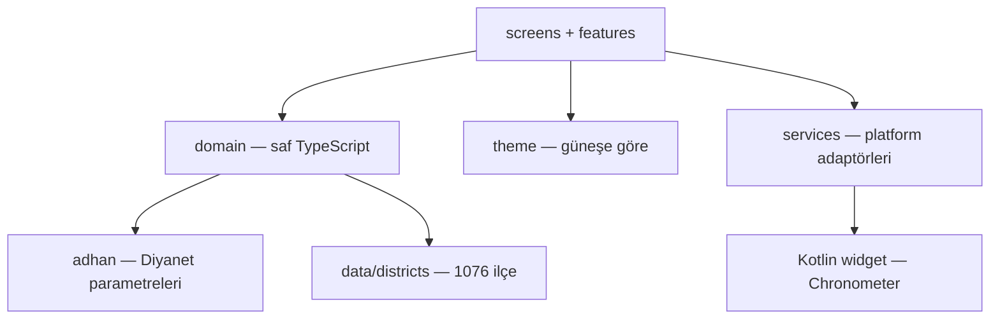

# KalkKıl

**Reklamsız, çevrimdışı, Diyanet ile aynı dakikayı gösteren namaz vakti uygulaması.**

Android · React Native · Kotlin widget · MIT

<p>
  
  
  
  
  
</p>

> **Durum:** v0.1 — çekirdek ve tasarım tamam, yayın için imzalama bekliyor
> ([docs/RELEASE.md](docs/RELEASE.md)).

## Neden

Piyasadaki namaz uygulamaları reklamla ve veri toplamayla ayakta kalıyor.
KalkKıl'ın üç kuralı var:

1. **Reklam yok.** Reklam, veri toplamak demek. Yok.
2. **Vakitler cihazda hesaplanır.** Konum hiçbir sunucuya gönderilmez,
   uygulama uçak modunda da çalışır. Dış çağrı yok.
3. **Diyanet ile aynı dakika.** Yöntem ve ilçe koordinatları, Diyanet'in
   yayınladığı saatlere karşı ölçülerek doğrulanır.

## Teknik olarak ilginç olan dört şey

**1. İlçe koordinatlarını Diyanet'in saatlerinden geri çözdüm.**
Açık kaynaklarda 973 ilçenin koordinatı yok (yalnızca il merkezleri var).
Ama Diyanet ilçe ilçe saat yayınlıyor. Öğle vakti boylamı neredeyse tek başına
veriyor (4 dk/derece); enlem 30 günlük pencerede farklı vakitlerden en küçük
karelerle çıkıyor. Sonuç: 868 ilçe, eğitim penceresinde ±1 dk, pencere dışındaki
günlerde ±2 dk. Ayrıntı: [Doğruluk](#doğruluk) · [`tools/build-districts.mjs`](tools/build-districts.mjs)

**2. Widget'ta servis yok.** Canlı geri sayım `RemoteViews` içindeki
`Chronometer` ile akıyor; Android'in kendi bileşeni işi yapıyor. Vakit geçişinde
`AlarmManager` widget'ı çeviriyor. Kalıcı bildirim ve foreground servis silindi:
pil tüketimi düştü, uygulama hiç açılmasa da widget 7 gün doğru kalıyor.

**3. Gün, zamanla orantılı bir eksen.** Ana ekran geri sayım + şerit + liste değil,
tek bir zaman diyagramı: imsak–güneş arası kısa, güneş–öğle uzun. Saat çentikleri
uzun aralıkları "boşluk" olmaktan çıkarıyor, kerahat aralıkları ince şerit,
"şimdi" ile sıradaki vakit arası vurgu renginde — kalan süre hem sayı hem uzunluk.

**4. Sessizce yanlış olabilecek her şey saf fonksiyon ve testli.**
Vakit hesabı, kerahat pencereleri, bildirim zamanlaması, widget planı ve önbellek
serileştirmesi `src/domain/` altında; React'ten bağımsız. 73 test, 8 suite.

## Özellikler

- **Vakitler** — Diyanet yöntemi; imsak, güneş, öğle, ikindi, akşam, yatsı.
- **İlçe bazlı konum** — 1076 ilçe. GPS yalnızca öneri sunar; vakit her zaman
  seçilen ilçenin Diyanet referans noktasından hesaplanır. Arama Türkçe karakter
  yazmadan çalışır ("kadikoy" → KADIKÖY).
- **Onboarding** — Karşılama, ilçe seçimi, bildirim izni. Konum burada seçilir;
  ana ekran bir daha GPS izni istemez.
- **Kerahat vakitleri** — Hanefi'ye göre üç pencere; eksende şerit, uyarı olarak
  da çıkar. (Piyasadaki çoğu uygulamada yok.)
- **Bildirimler** — Vakit bazında aç/kapa, vaktinde veya 5/15/30 dk önce.
  Tam zamanlı alarm, 7 günlük yuvarlanan plan.
- **Widget** — Sıradaki vakit ve canlı geri sayım ([yukarıda](#teknik-olarak-ilginç-olan-dört-şey)).
- **Kıble** — Manyetometre ile pusula; kardinal harfler dik kalır, hizalanınca
  titreşir.
- **Gün ışığına göre tema** — Gün doğumu–gün batımı arası açık, dışı karanlık.

## Doğruluk

Vakitler `adhan` kütüphanesinin Diyanet parametreleriyle hesaplanır (temkin
payları dahil: güneş −7, öğle +5, ikindi +4, akşam +7 dk).

**Yöntem.** Diyanet'in yayınladığı saatlerle, doğru koordinat verildiğinde:

| Konum | Karşılaştırma | Sapma |
|---|---|---|
| İstanbul (3 gün) | Diyanet tablosu — ilçenin kendi koordinatı | 0 – 1 dk |
| Kars / Akyaka | Diyanet tablosu — ilçenin kendi koordinatı | 0 – 1 dk |
| Kars / Akyaka | Aynı hesap, il merkezi koordinatıyla | ±2 dk |

Yöntem doğru; hata koordinatta. Bu yüzden Diyanet'in yıllık tablosunu gömmek
(~4 MB) yerine ~92 KB'lık ilçe koordinatı kullanılıyor.

**Koordinatlar.** 868 ilçe Diyanet'in saatlerinden çözüldü; eğitim penceresinde
867'si ±1 dk. Aşırı-uyum kontrolü (ilk yarıyla eğit, ikinci yarıda test):
medyan 1 dk, en kötü 2 dk. Diyanet'in yayınlamadığı 208 ilçe il merkezine
bağlandı ve `approximate` olarak işaretlendi.

Testler: [`districts.test.ts`](__tests__/domain/districts.test.ts) (gönderilen
koordinatlar + Diyanet tablosu) ve [`diyanet.test.ts`](__tests__/domain/diyanet.test.ts)
(yöntem).

## Mimari



```
src/
  domain/        saf TypeScript — vakit, kerahat, bildirim ve widget planı
  data/          üretilen ilçe listesi
  services/      platform adaptörleri
  theme/         palet, tipografi, güneşe göre tema
  ui/            Text, Divider, Chip, Button, EmptyState
  features/      onboarding, DayTimeline, NextPrayerHero
  screens/       Home, Qibla, Settings
android/         Kotlin widget, boot receiver, RN köprüsü
tools/           veri üretimi (tek seferlik, CI'da çalışmaz)
```

## Kurulum

```bash
npm install
npm run android
```

Gereksinimler: Node 18+, **JDK 17** (RN 0.76 + Gradle 8.10 JDK 21+ ile derlemez),
Android SDK 36.

## Doğrulama

```bash
npm run typecheck
npm run lint -- --quiet
npm test                        # 73 test, 8 suite
cd android && ./gradlew assembleDebug
```

CI her push/PR'de typecheck + lint + test çalıştırır (`--quiet` ile sadece
hatalar). Android derlemesi yerelde yapılır — ücretsiz kota harcamamak için.

## Yayın

Play Store'a yüklenmez; imzalı APK GitHub Releases üzerinden dağıtılır. Keystore
üretimi, secret'lar ve etiket akışı: [docs/RELEASE.md](docs/RELEASE.md).

## Kararlar

- [docs/DESIGN.md](docs/DESIGN.md) — görsel kimlik: palet (kontrast oranlarıyla),
  tipografi, bileşen kuralları, sevk öncesi kontrol listesi.
- [docs/DECISIONS.md](docs/DECISIONS.md) — neden böyle yapıldığı, ölçümlerle.
- [CHANGELOG.md](CHANGELOG.md)

## Lisans

MIT — bkz. [LICENSE](LICENSE).

