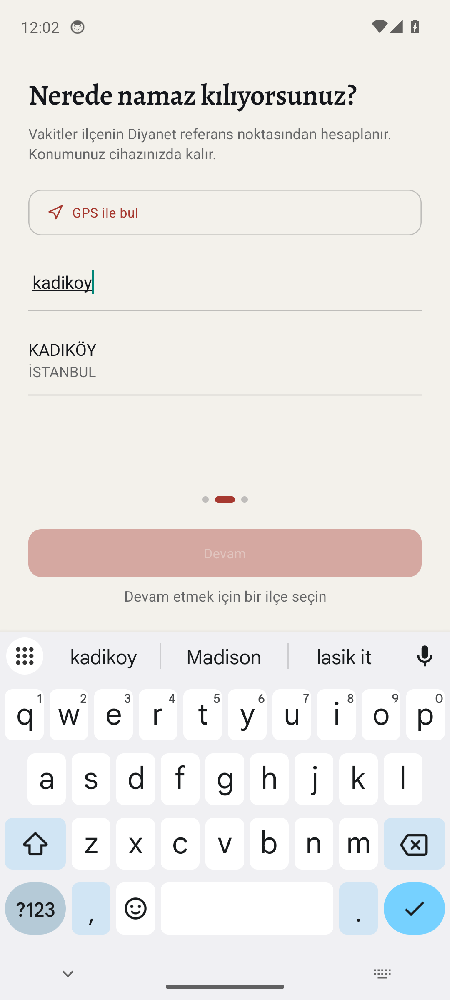
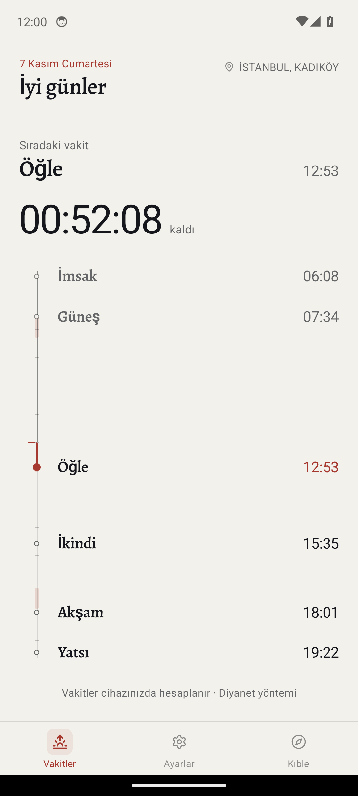
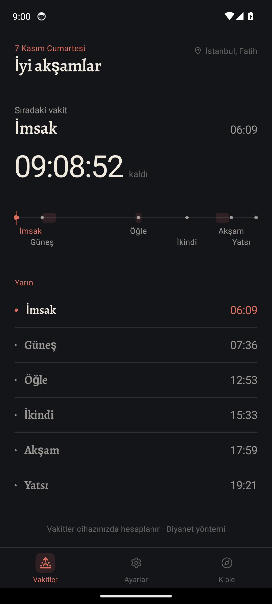
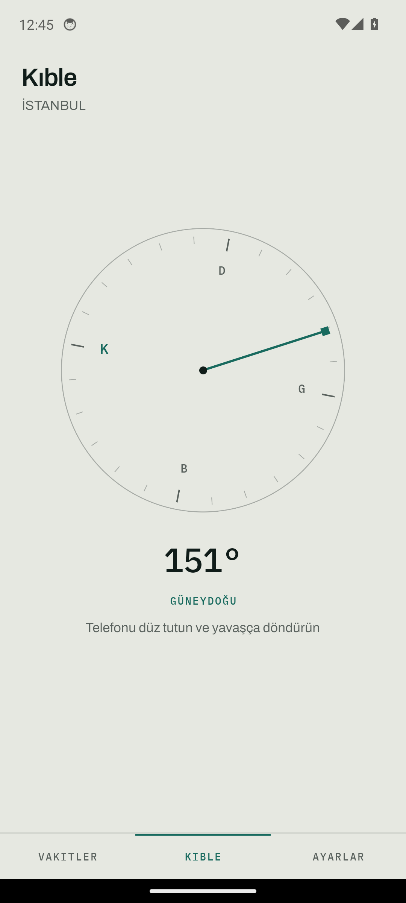
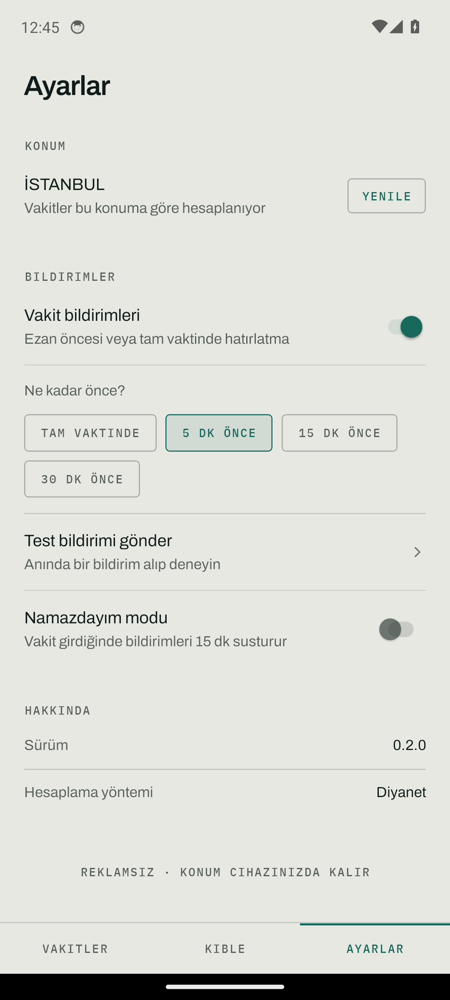

# KalkKıl

Reklamsız, çevrimdışı, Türkiye'ye göre doğru namaz vakti uygulaması.

<p>
  
  
  
  
  
</p>

## Neden

Piyasadaki namaz uygulamaları reklamla ve veri toplamayla ayakta kalıyor.
KalkKıl'ın üç kuralı var:

1. **Reklam yok.** Reklam, veri toplamak demek. Yok.
2. **Vakitler cihazda hesaplanır.** Konum hiçbir sunucuya gönderilmez,
   uygulama uçak modunda da çalışır.
3. **Diyanet ile aynı dakika.** Yöntem, Diyanet'in yayınladığı saatlerle
   test edilerek doğrulanır (aşağıda).

## Özellikler

- **Vakitler** — Diyanet yöntemiyle hesaplanır; imsak, güneş, öğle, ikindi,
  akşam, yatsı.
- **İlçe bazlı konum** — 1076 ilçe (81 il merkezi dahil). GPS yalnızca öneri
  sunar; vakit her zaman seçilen ilçenin Diyanet referans noktasından
  hesaplanır. Arama Türkçe karakter yazmadan çalışır ("kadikoy" → KADIKÖY).
- **Onboarding** — Karşılama, ilçe seçimi, bildirim izni. Konum burada seçilir;
  ana ekran bir daha GPS izni istemez.
- **Gün Çizgisi** — Günü dikey ve **zamanla orantılı** bir eksen olarak
  gösterir: vakitler düğüm, saatler çentik, kerahat aralıkları ince şerit.
  "Şimdi" ile sıradaki vakit arasındaki eksen parçası vurgu renginde — kalan
  süre hem sayıyla hem uzunlukla.
- **Kerahat vakitleri** — Hanefi'ye göre üç kerahat penceresi; gün çizgisinde
  şerit olarak görünür, uyarı olarak da çıkar.
- **Bildirimler** — Her vakit için ayrı aç/kapa; vaktinde veya 5/15/30 dk
  önce. Tam zamanlı alarm, 7 günlük yuvarlanan plan.
- **Widget** — Ana ekranda sıradaki vakit ve canlı geri sayım. Sayaç
  `Chronometer` ile native akar; arka planda servis çalışmaz, uygulama
  açılmasa da 7 gün doğru kalır.
- **Kıble** — Manyetometre ile pusula: kardinal harfler dik kalır, iğne kıbleyi
  gösterir, hizalanınca titreşir ve renk döner.
- **Gün ışığına göre tema** — Gün doğumu–gün batımı arası açık, dışı karanlık.

## Doğruluk

Vakitler `adhan` kütüphanesinin Diyanet parametreleriyle hesaplanır (temkin
payları dahil: güneş −7, öğle +5, ikindi +4, akşam +7 dk). Doğruluk, Diyanet'in
kendi yayınladığı saatlerle test edilir:

| Konum | Karşılaştırma | Sapma |
|---|---|---|
| İstanbul (3 gün) | Diyanet tablosu — ilçenin kendi koordinatı | 0 – 1 dk |
| Kars / Akyaka | Diyanet tablosu — ilçenin kendi koordinatı | 0 – 1 dk |
| Kars / Akyaka | Aynı hesap, il merkezi koordinatıyla | ±2 dk |

Yöntem doğru; hata koordinatta. Bu yüzden Diyanet'in yıllık tablosunu gömmek
yerine ilçe koordinatı kullanılır.

İlçe koordinatları açık kaynaklarda yok (yalnızca il merkezleri var). Bu yüzden
her ilçenin koordinatı, Diyanet'in o ilçe için yayınladığı saatlerden **en küçük
kareler ile geri çözüldü** (`tools/build-districts.mjs`):

- 868 ilçe çözüldü; eğitim penceresinde 867'si ±1 dk, en kötüsü 2 dk.
- Aşırı-uyum kontrolü: pencerenin ilk yarısıyla eğitip ikinci yarısında test
  edildi — medyan 1 dk, en kötü 2 dk, hiçbiri 2 dk'yı geçmiyor.
- Diyanet'in yayınlamadığı 208 ilçe il merkezine bağlandı ve `approximate`
  olarak işaretlendi.

Testler: `__tests__/domain/districts.test.ts` (gönderilen koordinatlar +
Diyanet tablosu, ±2 dk) ve `__tests__/domain/diyanet.test.ts` (yöntem).

## Mimari

```
src/
  domain/        React yok, saf TypeScript — vakit, kerahat, bildirim ve widget planı
  data/          Üretilen ilçe listesi (tools/build-districts.mjs)
  services/      Platform adaptörleri: bildirim, konum, depolama, widget köprüsü
  theme/         Palet, tipografi, güneşe göre tema seçimi
  ui/            Text, Divider, EmptyState — ekranlar stil objesi yazmıyor
  features/      onboarding, DayTimeline, NextPrayerHero
  screens/       Home, Qibla, Settings
  i18n/          Arayüz metinleri (v1 tek dil)
  hooks/         usePrayerTimes, useCountdown
android/         Kotlin widget, boot receiver, RN köprüsü
```

Domain katmanı React'ten bağımsız olduğu için "sessizce yanlış olabilecek" her
şey (vakit hesabı, kerahat, bildirim saatleri, önbellek serileştirme) test
edilebilir durumda. Ekranları değiştirmek bu katmana dokunmaz.

## Kurulum

```bash
npm install
npm run android
```

Gereksinimler: Node 18+, JDK 17 (RN 0.76 ve Gradle 8.10 JDK 21+ ile derlemez),
Android SDK 36.

## Doğrulama

```bash
npm run typecheck
npm run lint -- --quiet
npm test                                    # 47 test
cd android && ./gradlew assembleDebug
```

CI (`.github/workflows/ci.yml`) her push/PR'de typecheck + lint + test çalıştırır.
Android derlemesi yerelde yapılır.

## Yayın

Play Store'a yüklenmez; imzalı APK GitHub Releases üzerinden dağıtılır.
Keystore üretimi, secret'lar ve etiket akışı: [docs/RELEASE.md](docs/RELEASE.md).

## Kararlar

- [docs/DESIGN.md](docs/DESIGN.md) — görsel kimlik: palet, tipografi, bileşen kuralları,
  sevk öncesi kontrol listesi.
- [docs/DECISIONS.md](docs/DECISIONS.md) — neden böyle yapıldığı, ölçümlerle.

## Lisans

MIT
