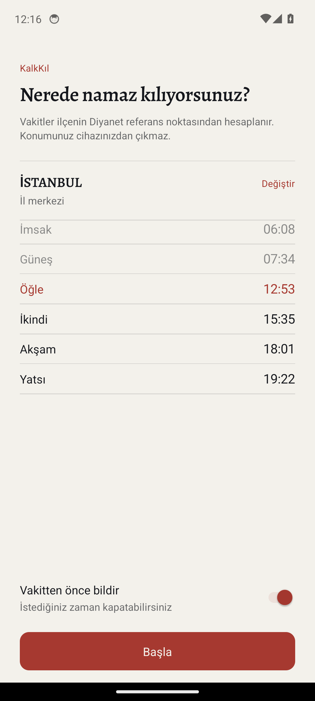

# KalkKıl

Reklamsız, çevrimdışı, Diyanet ile aynı dakikayı gösteren namaz vakti uygulaması.

Android · React Native · Kotlin widget · MIT

<p>
  
  
  
</p>

**Üç kural:** reklam yok · konum cihazdan çıkmaz · vakitler Diyanet ile aynı dakikada.

## Özellikler

- **Vakitler** — Diyanet yöntemiyle cihazda hesaplanır. Uçak modunda çalışır.
- **İlçe bazlı konum** — 1076 ilçe; GPS sadece önerir. Arama “kadikoy” ile de
  bulur.
- **Gün Çizgisi** — Günü dikey, zamanla orantılı eksen olarak gösterir: vakitler
  düğüm, saatler çentik, kerahat aralıkları şerit. Kalan süre hem sayı hem uzunluk.
- **Widget** — `Chronometer` ile canlı geri sayım; arka planda servis yok,
  uygulama açılmasa da 7 gün doğru kalır.
- **Bildirimler** — Vakit bazında, 5/15/30 dk önce veya tam vaktinde.
- **Kıble**, **kerahat vakitleri**, **gün ışığına göre tema**.

## Doğruluk

Diyanet'in yayınladığı saatlere göre, doğru koordinatla sapma **0–1 dk**.
İlçe koordinatları açık kaynaklarda yok; Diyanet'in kendi saatlerinden en küçük
karelerle geri çözüldü — 868 ilçede eğitim penceresi ±1 dk, pencere dışı ±2 dk.
Ayrıntı: [docs/DECISIONS.md](docs/DECISIONS.md) · [`tools/build-districts.mjs`](tools/build-districts.mjs)

## Kurulum

Node 18+, **JDK 17**, Android SDK 36.

```bash
npm install
npm run android
```

## Doğrulama

```bash
npm run typecheck && npm run lint -- --quiet && npm test   # 84 test
cd android && ./gradlew assembleDebug
```

## Belgeler

- [docs/DESIGN.md](docs/DESIGN.md) — palet, tipografi, bileşen kuralları
- [docs/DECISIONS.md](docs/DECISIONS.md) — kararlar ve ölçümler
- [docs/RELEASE.md](docs/RELEASE.md) — imzalı APK, GitHub Releases
- [CHANGELOG.md](CHANGELOG.md)

MIT — [LICENSE](LICENSE)

